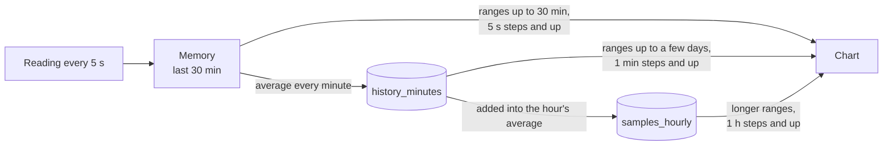

# Database and history

Every device with a website keeps its history in one SQLite file. A hub keeps the history of every device it collects from in its own file. A data-only device keeps no history, only the minutes the hub has not fetched yet, in a `buffer` table in the same kind of file, with how far each hub has fetched them in `buffer_hubs` and how its extras are described in `buffer_extra_info`, and no other table (see [While the hub is away](architecture.md#while-the-hub-is-away)).

- [Where the file is](#where-the-file-is)
- [Tables](#tables)
- [From reading to chart](#from-reading-to-chart)
- [Retention](#retention)
- [Size](#size)
- [Updates to the layout](#updates-to-the-layout)
- [Backups](#backups)

## Where the file is

| Install | File |
| --- | --- |
| Docker | `/data/usage-control.db` in the container, on the `data` volume, so it survives updates and recreated containers |
| Linux service | `/var/lib/den-watcher/usage-control.db` |
| Windows | `C:\ProgramData\Usage Control\usage-control.db`; uninstalling keeps it, unless **Delete the history** is ticked on the installer's Remove page or `msiexec /x` gets `DELETE_HISTORY=1` |
| From source | `usage-control.db` in the folder the program was started from |

`DATABASE_PATH` moves it. The driver is a pure-Go SQLite, so the binary needs no C library. The file uses write-ahead logging (WAL), so the page can read while the recorders write; next to it you will see `usage-control.db-wal` and `usage-control.db-shm`, which belong to it.

## Tables

| Table | Holds | Kept |
| --- | --- | --- |
| `history_minutes` | one row per device and minute: `device`, `time` (Unix seconds) and `data`, the minute's values as float32, each with the id of its metric (see `history_metrics`) | for the retention |
| `history_metrics` | the name of each metric a value is stored under: `id`, `name` | for good; a name takes about 30 bytes |
| `samples_hourly` | the average of each hour per device and metric, with `count`, how many minute values it is over | for the retention |
| `extra_info` | how each stored [extra](data.md#extras) is described: `device`, `metric`, `info` (title, label and unit as JSON), `written` (Unix seconds) | while the extra has values, or for the retention after it was last written |
| `wifi_hours` | what each device's [Wi-Fi add-on](setup.md#add-ons) saw nearby, one row per device, hour and access point: `device`, `time` (Unix seconds, the start of the hour), `ap` and `box` (hashes of the access point's hardware address and of its middle four bytes, which the radios of one router share), `ssid`, `frequency` and `width` (MHz), `security`, `generation`, as last seen in the hour, and `seen` (readings it was in), `connected` (of those, the ones the device was connected to it), `signal_sum`, `signal_min`, `signal_max` (percent) and `dbm_sum` of `dbm_count` readings. Written with the minutes every `HISTORY_FLUSH_MINUTES`, adding to the hour's row | for the retention, or until the device is removed without its history |
| `wifi_scans` | per device and hour, `readings`: how many of the device's readings had its Wi-Fi add-on, so an access point `seen` in fewer was in range for that part of the hour | as `wifi_hours` |
| `hub_devices` | devices added on the page: `id`, `name`, `address` (empty for a [phone](architecture.md#phones)), `added` | until removed on the page |
| `hub_kept` | per device removed on the page with *Keep its history* ticked: `device`, whose availability and kind are kept too, and `removed` (Unix seconds). Added again, its `since` in `hub_watched` moves on by the time it was removed, so that time is not counted as available | until a device with the same name is added again, or for the retention, after which its availability, kind, alerts and events are deleted too |
| `buffer` | data-only devices: one row per minute and metric of the device's own usage, `time`, `metric`, `value` | until every hub has fetched it, at most `BUFFER_HOURS` |
| `buffer_hubs` | data-only devices: per hub, by the id it sends (so a hub whose address changes, as with IPv6 privacy addresses, keeps one row), `fetched`, the newest minute it has, `sent`, the newest handed to it, and `asked`, when it last asked (Unix seconds) | while it is one of the 16 hubs that asked most recently |
| `buffer_extra_info` | data-only devices: how each of its own [extras](data.md#extras) is described, as `extra_info` without `device` | for `BUFFER_HOURS` after it was last written |
| `pairing_code` | this device's [pairing code](architecture.md#pairing), which a hub must be given to collect its usage; made at random once, one row | for good |
| `pairing_hubs` | per hub that gave the pairing code, by the id it sends, or that already collected when the device was updated to pairing: `hub`, `paired` (Unix seconds) | for good |
| `hub_pairing_codes` | per other device that was given one on the hub: `device`, `code`, the pairing code the hub sends it, or the one a phone sends the hub | as long as the device is collected from, or kept with its history |
| `hub_watched` | per other device, since when the hub collects from it | as long as the device is collected from, or kept with its history |
| `hub_outages` | per other device, every time it did not answer: `started`, `ended` (Unix milliseconds) | as long as the device is collected from, or kept with its history |
| `hub_phone_secret` | the secret the hub makes each phone's key from (see [Phones](architecture.md#phones)); made at random once | for good |
| `hub_phone_keys_given` | `key_hash`, a SHA-256 of each phone key the hub gave, as it gives each only once; deleted when the phone is allowed to change its hub | for good |
| `hub_id` | the hub's own id, which it sends to every device, so a device that keeps its minutes for the hub tells it apart from other hubs; made at random once | for good |
| `hub_mesh_nodes` | per node of a router's mesh (an ASUS AiMesh) that the hub shows as a device: `router` (the main router's device id), `node` (the node's hardware address), `device`, `name` and `address`, so the node keeps its device and name across restarts | as long as the main router is in `HUB_ROUTERS` and lists the node, or until the node was missing from its list for an hour |
| `hub_device_kinds` | per other device that is a PC or laptop or a phone: `device`, `kind` (`pc` or `phone`); a device without a row is a server or IoT device | as long as the device is collected from, or kept with its history |
| `alerts` | every [alert](data.md#alerts): `device`, `device_name`, `kind`, `subject`, `level` and `value` (the highest reached), `started`, `ended` (Unix milliseconds, empty while it lasts) | while it lasts, then for the retention, or until the hub forgets its device: removed on the page without its history, taken out of `HUB_DEVICES`, `HUB_ROUTERS` or `HUB_CHECKS`, or removed with its history longer than the retention ago |
| `events` | the reboots and updates of each device, for the [marks on the charts](data.md#events-on-the-charts): `device`, `time` (Unix milliseconds), `kind` (`reboot` or `update`), `detail` (the new version of an update) | for the retention, or until the hub forgets its device, as for `alerts` |
| `events_seen` | per device, its uptime in seconds and version of den-watcher at a recent reading, and `written` (Unix milliseconds), so a reboot or update while the hub was stopped is noticed at its start; written when they change, and the uptime at most every 10 minutes | one row per device, until the hub forgets it, as for `alerts` |
| `password` | the salt and PBKDF2-SHA256 hash of the password for changing devices, one row at most | until `RESET_PASSWORD=true` |
| `page_layout` | how the page is arranged: the folded categories, the order of the cards, the hidden ones, the pinned ones, the values made into cards, the widths of the cards and whether they are grouped by category, as JSON in `layout`, one row at most; see `PUT /api/layout` in [the HTTP API](architecture.md#http-api) | until the page changes it |
| `wifi_places` | the places named on the page under *Wi-Fi nearby*, each with what a device heard there, as JSON in `places`, one row at most; see `PUT /api/wifi/places` in [the HTTP API](architecture.md#http-api) | until the page changes them |

A minute is one row, not one row per value: the device's and the metric's names, the row's overhead and an index are paid once per minute instead of once per value, which takes about a twentieth of the space and of what is written to the SD card. A value is a float32, about 7 digits, which is more than a chart shows. `history_minutes` uses `(device, time)` as the key, so a device's minutes and the old ones of each device are ranges of it; `samples_hourly` uses `(device, time, metric)`; both are stored without a separate row id, `samples_hourly` with an index by time for deleting old rows. The metric names are listed in [What is kept in the history](data.md#what-is-kept-in-the-history). A new metric or a new device needs no change to the tables. Devices from `HUB_DEVICES` are not stored; they are read from the setting at every start. Their kind is stored, though, which is why it is a table of its own rather than a column of `hub_devices`; it also needs no migration, since a database without the table holds servers only.

## From reading to chart



**Writing.** Each device's recorder takes a reading every 5 seconds and keeps the readings of the last 30 minutes in memory. Every minute, at its 55th second (a hub's recorder of another device at second 5 of the next minute, see [While the hub is away](architecture.md#while-the-hub-is-away)), it writes their average to `history_minutes`, at the start of that minute, and, in the same transaction, adds it into the running average of the hour in `samples_hourly`. A value that is in its minute already, as when a hub stored a minute itself and later fetches the device's, is not written again, so it counts once in its hour; only what the minute lacks, such as how long the device took to answer, is added to it. The minutes of all devices wait in memory and are written together every `HISTORY_FLUSH_MINUTES` (default 10, from 1 to 60), in one transaction, with one update of each hour's average per metric instead of one per minute: a write to the database touches the same pages for ten minutes as for one, so the SD card of a Raspberry Pi is written to a tenth as often. Charts, the minutes a hub fetches and the newest time include the minutes that wait; the hourly averages, and so ranges over 5 days, are up to that long behind. A power cut or crash loses the minutes that wait; stopping the program, an update or a backup writes them first. The first reading after a start is not kept, since its CPU usage is the average since the machine booted.

**Reading.** The page opens on the last 30 minutes. A chart asks for a range and gets at most 360 points per metric, each the average over one step:

- Ranges up to 30 minutes come from memory, in steps of 5 seconds or more.
- Longer ranges come from `history_minutes`, in steps of whole minutes.
- As soon as a step would be over 20 minutes (ranges over 5 days), it is made whole hours, and the values come from `samples_hourly`, weighted by `count`, which gives the same averages from 60 times fewer rows. A 7-day range then has 168 points. The first step then has the whole step the range starts in.
- Where memory has a gap of a few missed readings, as after the hub could not reach a device, or does not reach back far enough yet, as after a restart, only the steps of the gap come from the database: each gets the value of its minute there, such as one the hub fetched from the device since. The rest of the range still comes from memory. A minute is stored at its start but averages the readings of the minute before it was stored, so a step right next to a gap can show a value up to about a minute older than its time; it only shapes how the gap is drawn. A short range with no reading in memory at all comes from the database in 1-minute steps, so the chart is never empty.
- Database answers are kept for up to a minute per device and step, so every open tab and every viewer of the hub share one query.

A device that did not answer has no values for that time, which shows as a gap in its chart. While a device does not answer, a range that ends after its newest reading is moved back to end there, keeping its length, so its charts show the last data there is instead of an empty range. The newest reading comes from memory, or after a restart from `history_minutes` (one row of the primary key).

## Retention

`RETENTION_DAYS` (default 30, from 1 to 3650) sets how long values are kept, for every device on the hub alike. Once at start and then once a day, everything older is deleted from `history_minutes`, `samples_hourly`, `wifi_hours` and `wifi_scans`. It is deleted 5,000 rows at a time, each in a transaction of its own, so a large cleanup (the first after a long downtime, or after shortening `RETENTION_DAYS`) never keeps the recorders from storing for long; afterwards the write-ahead log is shrunk back. The API never returns values older than the retention, so values waiting for the next cleanup are not shown. When more is kept than the longest range the page offers within it (for example 10 days, where the longest is 7 days), the page also offers an *All* range.

Changing `RETENTION_DAYS` takes effect at the next start. Shortening it deletes the older values then; lengthening it cannot bring back what was already deleted.

Alerts and events (reboots and updates) are deleted once they are older than the retention too, checked every hour. Outages and the list of devices are not bound to the retention: they are kept as long as the device is. The one exception is a device removed with its history kept: its availability and kind are kept with it, and deleted once it was removed longer than the retention ago, unless a device with the same name was added again, on the page or in `HUB_DEVICES`.

## Size

Each kept minute is one row of a few bytes per value, and each hour has one row per value. As a guide, measured with a SQLite file filled like a Raspberry Pi's history (15 values per minute: CPU, memory, swap, two temperatures, one disk with read and write, three network cards, GPU), at about 6.5 bytes per value and minute:

| Values per device | Per day | 30 days | 365 days |
| --- | --- | --- | --- |
| 15 (a Raspberry Pi) | about 140 KB | about 4 MB | about 50 MB |
| 30 (a PC with more disks and cards) | about 280 KB | about 8 MB | about 100 MB |

A hub's file is the sum over its devices. A data-only device's buffer holds only minutes, no hours, and normally just one; while the hub cannot reach it, it grows with one row per value, up to `BUFFER_HOURS`: about 3 MB for a PC's 24 hours, about 20 MB for a week. `HISTORY_MAX_ENTRIES` (default 64) caps how many disks, sensors, network cards and GPUs each a device can add, and how many groups of extras and values per group, so one device with hundreds of virtual network cards cannot fill the disk. Each extra with `history: true` counts as one more value per device, at most 8 × `HISTORY_MAX_ENTRIES` (512) of them, and metric names are at most 256 bytes long.

Deleted rows leave free pages in the file, which SQLite reuses for new values; the file does not shrink on its own. The write-ahead log (`usage-control.db-wal`) does: after a cleanup that deleted more than 5,000 rows it is truncated.

Metric names are never deleted from `history_metrics`; a device whose extras are named after things that come and go (containers, say) adds a name of about 30 bytes for each new one.

## Updates to the layout

The file's layout version is kept in SQLite's `user_version`. When a new version of den-watcher changes the layout:

1. It copies the file to `usage-control.db.backup` next to it, replacing an older copy; not for version 3, see below.
2. It updates the file in one transaction.

An older version refuses to start on a file a newer version has changed, instead of damaging it, and says so in its log. To go back, put the old version and the `.backup` copy in place.

| Version | Change |
| --- | --- |
| 1 | the first layout: `samples`, plus the hub and password tables created when first used |
| 2 | adds `samples_hourly` and fills it from the values already kept |
| 3 | stores a minute as one row in `history_minutes` instead of one row per value in `samples` |

> **No way back from version 3 (den-watcher 3.0.0) without losing the history.** Once 3.0.0 has started on a file, earlier versions refuse it, and there is no `.backup` copy to go back to. Before updating a hub to 3.0.0, download a backup of its database (**Download backup** in the devices dialog, see [Backups](#backups)); to go back to an earlier version later, put that file in place, which loses what was recorded since.

Version 3 moves the values already kept when the program starts, one device and one day at a time, and drops `samples` after the last one. It makes no copy of the file first: nothing is deleted before everything is converted, and a start that is cut short goes on with the first day it had not converted. The hub does not answer while it runs: it took 3 seconds for a file of 130 MB on a PC, and takes longer on a Raspberry Pi, in proportion to the size of the file. Afterwards the file shrinks to a twentieth of its size, if the temporary folder has room for a copy of what is kept; otherwise it keeps its size and the free space is reused. It needs room for the new rows next to the old ones while it runs.

## Backups

The file holds everything a device keeps: history, added devices with their addresses, outages, alerts and the password hash. It holds no router passwords: those are kept apart (see [Show the router](setup.md#5-show-the-router)). Still, keep a backup private, as it tells which devices are on the network and where.

The easiest way is the hub's *Devices* dialog: **Download backup** asks for the password, like a change to the devices, and the browser saves the file as `den-watcher-<date>.db`. The hub makes a consistent copy with SQLite's `VACUUM INTO` while it keeps recording, into a temporary file next to the database (`.den-watcher-backup-*.db`), and deletes that once it is sent, or could not be; one left by a stop in between is deleted at the next start. The copy needs as much free space next to the database as the database takes without its free pages. Before a password is chosen, the first backup chooses it, as the first change does. A data-only device has no page and offers none; its file only holds the minutes the hub has not fetched yet.

To restore, stop den-watcher, put the downloaded file in place of the database under its name (`usage-control.db`), delete the `-wal` and `-shm` files next to it, and start it again.

By hand, copy the file while den-watcher is stopped, or use SQLite's `.backup` command while it runs. With Docker:

```bash
docker compose stop
docker run --rm -v den-watcher_data:/data -v "$PWD":/backup alpine cp /data/usage-control.db /backup/
docker compose start
```

The volume's name is the folder of `compose.yaml` followed by `_data`: `den-watcher_data` above, and `usage-control_data` in a folder from before the rename. `docker volume ls` lists it.

A copy of a hub's file carries the hub's id (`hub_id`). Restoring it on the same hub is fine. When the copy starts a second hub while the first one still runs, both send the same id, and a data-only device takes them for one hub: it deletes the minutes either has fetched, so the other misses them while it cannot reach the device. Give the second hub an id of its own by deleting the row while it is stopped; it makes a new one at its next start. The image has no `sqlite3`, so with Docker:

```bash
docker compose stop
docker run --rm -v den-watcher_data:/data alpine sh -c 'apk add -q sqlite && sqlite3 /data/usage-control.db "DELETE FROM hub_id"'
docker compose start
```

For the Linux service or Windows, stop it and run `sqlite3 usage-control.db "DELETE FROM hub_id"` on the file in `DATABASE_PATH`.
